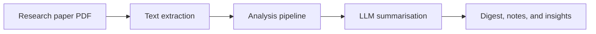

# DigestAI

## Project contribution

Reduces the time needed to understand research papers by extracting key material and producing concise, actionable digests.

## Architecture


**Research Paper Digestion Powered by AI**

DigestAI is a lightweight tool that takes research papers (PDFs) and automatically generates:  

- ✨ **Concise summaries** (TL;DR + key bullets)  
- 🔍 **Related works** (via semantic search & references)  
- 💡 **Key insights** (methods, results, limitations, future work)  
- 📊 **Auto-generated slide decks** (PowerPoint format)

Perfect for students, researchers, and professionals who want to **understand papers faster** without drowning in 30+ pages of text.  

## 🚀 Features  

- **Upload PDFs** → instantly digest research content  
- **Summarization** → TL;DR + 3–5 bullets  
- **Semantic search** → retrieve related works using embeddings + ChromaDB  
- **Slide deck generation** → automatic PPTX ready for presentations  
- **References parsing** → extract citations (optional extension)  

## 📂 Project Structure
├─ digestai.ipynb

└─ README.md

## 🚀 Quick Start

### 1. Clone the Repository
```bash
git clone https://github.com/AryaLolusare2712/DigestAI.git
cd DigestAI
```

### 2. Install Dependencies
```bash
pip install -r requirements.txt
```

### 3. Set Up API Keys
Create a .env file in the project root with:
```env
GEMINI_API_KEY=your_google_gemini_api_key_here
```
Getting API Keys:

Google Gemini API Key: Sign up at Google AI Studio
 (free tier available).

(Optional) Semantic Scholar API Key: Sign up at Semantic Scholar API
 if you want to enable external related works lookup.

### 4. Run the App
Start the Gradio app locally:
```bash
python digestai.py
```

